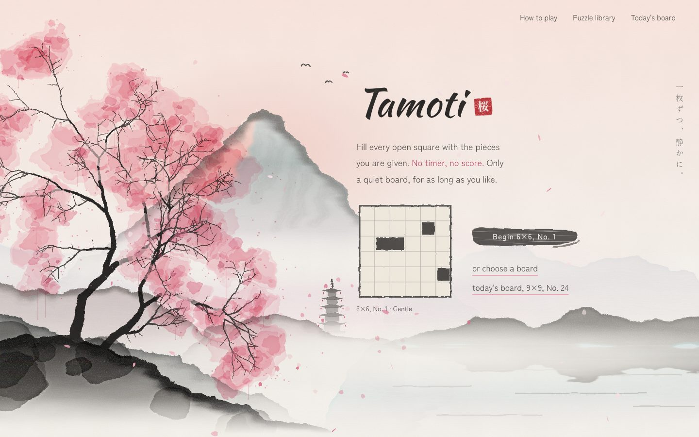
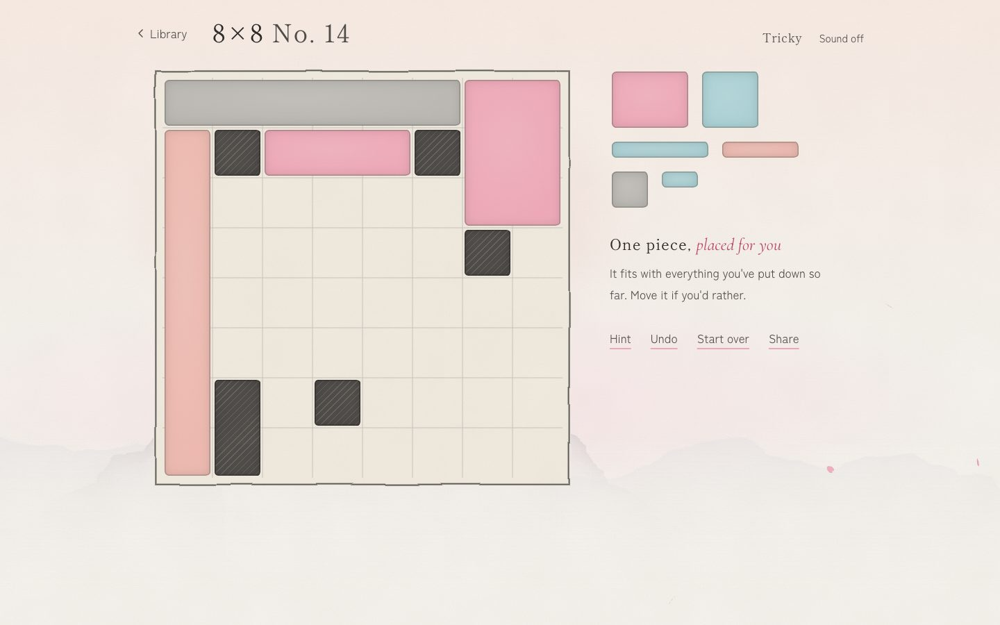
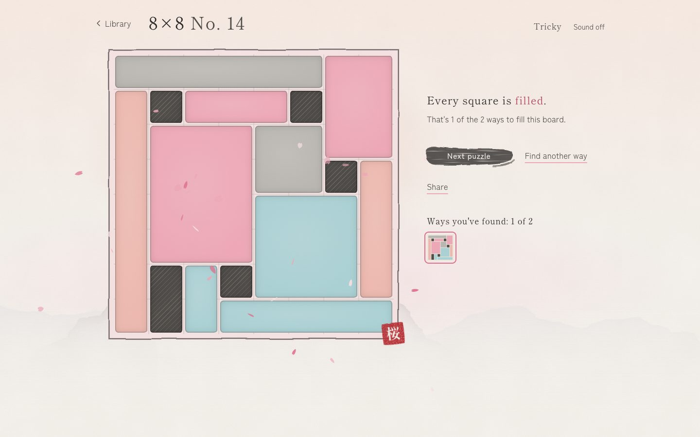
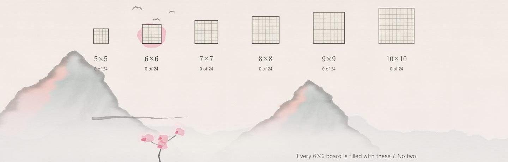
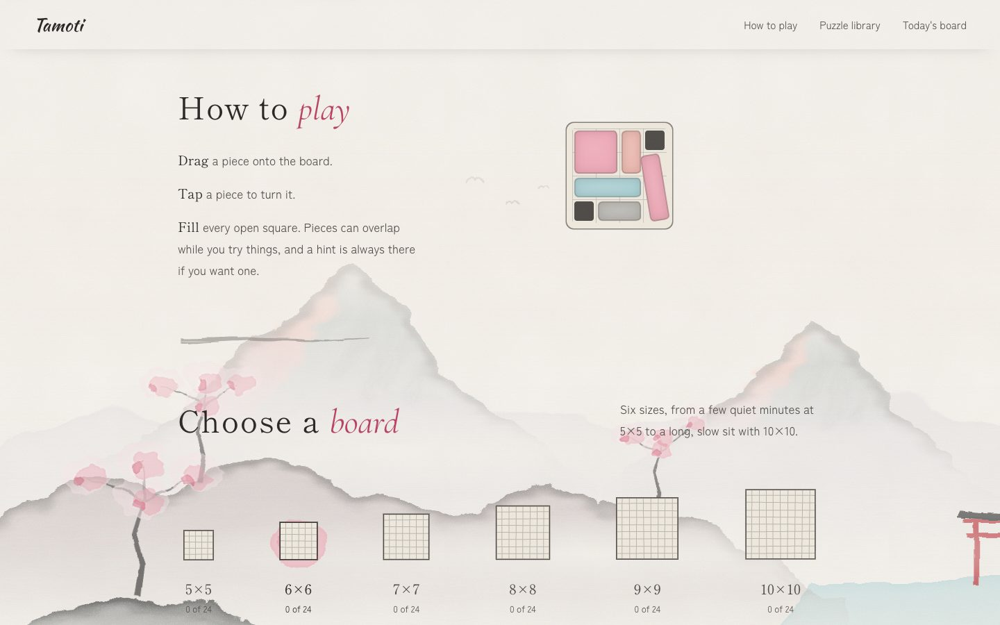
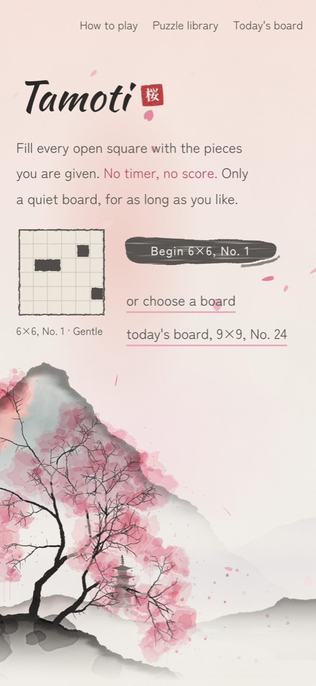
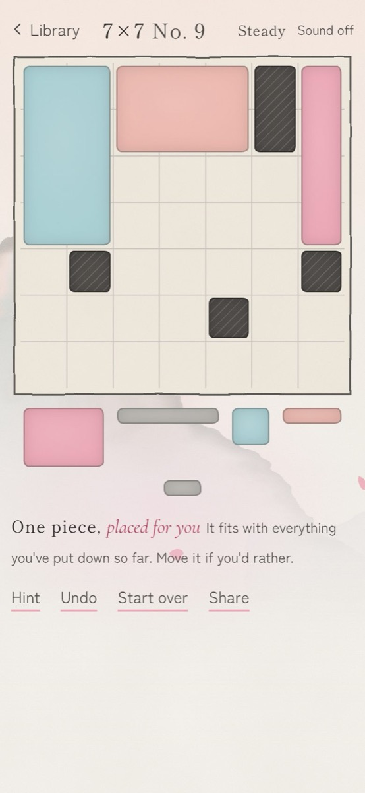

<div align="center">



# Tamoti

**A calm tiling puzzle, painted like a Japanese ink-and-watercolour scroll.**

Fill every open square of the board with the pieces you are given.<br>
No timer, no score. Only a quiet board, for as long as you like.

[**▶ Play it at tamoti.vercel.app**](https://tamoti.vercel.app)

[](https://github.com/Shabd0775-encrypt/tamoti/actions/workflows/ci.yml)
[](LICENSE)


</div>

---

## Contents

- [About](#about)
- [Screenshots](#screenshots)
- [Features](#features)
- [How to play](#how-to-play)
- [How it works](#how-it-works)
- [Design](#design)
- [Accessibility](#accessibility)
- [Getting started](#getting-started)
- [Project structure](#project-structure)
- [Testing](#testing)
- [Deployment](#deployment)
- [Contributing](#contributing)
- [License](#license)

## About

Tamoti is a rectangle-tiling puzzle for the browser. Each board is a square grid, 5×5 to 10×10, with a few squares blocked off in ink. You get a set of rectangles, every one a different shape, and your job is to cover every open square exactly once.

It is built as a calm alternative to the feed: something to reach for in a short break, while winding down at night, or as a small daily ritual. There is no fail state, no streak to protect and no penalty for asking for a hint. When you finish a board, it tells you how many ways there are to fill it, and invites you to find the others if you're curious.

The whole site is painted in code. The cherry trees, mountains, lake, falling petals and the long scroll painting behind the puzzle library are drawn with SVG, canvas and CSS. There are no image or sound files to download.

## Screenshots

<table>
  <tr>
    <td width="50%"></td>
    <td width="50%"></td>
  </tr>
  <tr>
    <td align="center"><sub>Part-way through an 8×8 board, with a hint just placed</sub></td>
    <td align="center"><sub>Solved: one of two ways to fill it, sealed in red</sub></td>
  </tr>
  <tr>
    <td width="50%"></td>
    <td width="50%"></td>
  </tr>
  <tr>
    <td align="center"><sub>The puzzle library over the scroll painting</sub></td>
    <td align="center"><sub>How to play, with a small animated demo</sub></td>
  </tr>
</table>

<p align="center">
  
  &nbsp;&nbsp;
  
</p>
<p align="center"><sub>On a phone, the board and its pieces fit on one screen.</sub></p>

## Features

- **144 hand-picked boards.** 24 for each size from 5×5 to 10×10, in four tiers: Gentle, Steady, Tricky and Deep. Every one is checked by a solver to have a solution, and only one to three of them.
- **Today's board.** One puzzle a day, the same for everyone, picked from the date alone, with no server.
- **Free play.** Pieces can overlap while you try things and turn in place on the board. The game never refuses a move; the board is solved once every open square is covered exactly once.
- **Gentle hints.** A hint either places one more piece that fits with what you have, or points out the piece that rules out every solution.
- **Ways found.** After solving, see how many solutions the board has, and keep a small gallery of the ones you've found.
- **Share a board** by link, through the phone's share sheet or the clipboard.
- **Play anywhere.** Mouse, touch (pieces ride above your finger so you can see where they land) and full keyboard play.
- **Soft sounds,** off by default: a wooden *tok* when a piece goes down, and a three-note chime when a board is filled.
- **No account, no tracking.** Progress and solutions you've found are kept in your own browser.

## How to play

Drag a piece from the tray onto the board. Fill every open square; the dark ones stay as they are.

| Action | Mouse / touch | Keyboard |
| --- | --- | --- |
| Pick a piece | Press and drag it | <kbd>Tab</kbd> to it |
| Put it on the board | Drop it where it should go | <kbd>Enter</kbd> or <kbd>Space</kbd> |
| Move it | Drag it | <kbd>←</kbd> <kbd>↑</kbd> <kbd>→</kbd> <kbd>↓</kbd> |
| Turn it 90° | Tap it (or tap with a second finger mid-drag) | <kbd>R</kbd> |
| Send it back to the tray | Drag it off the board | <kbd>Delete</kbd> or <kbd>Backspace</kbd> |
| Drop a piece mid-drag | | <kbd>Esc</kbd> |

Hint, Undo, Start over and Share sit beside the board.

## How it works

### Building the puzzle library

The boards are made ahead of time by [`scripts/build-library.ts`](scripts/build-library.ts) and shipped as [`src/game/library.json`](src/game/library.json). Each board size has one fixed set of pieces (5 pieces for 5×5, up to 13 for 10×10), all different shapes, so a puzzle is just a choice of where the blockers sit. For each size the script:

1. **Drops blockers in tough spots,** away from the edge and not touching each other, many times over.
2. **Counts the solutions** with a fast exact counter that always works on the tightest spot: the piece with the fewest places left to go, or the open square the fewest pieces can reach. It keeps only layouts with very few solutions (at most 2, or 3 on the smallest boards), since fewer ways to fill a board make a sharper puzzle.
3. **Rates how hard each layout is for a person,** not for a computer (see below), leaves out the easiest 40%, and spreads 24 boards evenly over the rest, easiest first.

The random choices are seeded, so the library builds the same way every time. Run it with `npm run build:library` (it takes several minutes).

### Human-style difficulty

People solve these boards mostly through forced moves: *"this long piece only fits in one place"*, or *"only one piece can reach this corner"*. Only when those run out do they have to guess. [`src/game/difficulty.ts`](src/game/difficulty.ts) solves the same way: it makes every forced move it can, and when stuck, guesses at the spot with the fewest choices. A board's score is how much guessing it needed, where each guess between *k* choices costs log₂(*k*). A 50:50 guess costs 1; a board solved by forced moves alone scores 0.

### Solver and hints

[`src/game/solve.ts`](src/game/solve.ts) is a backtracking solver. It always looks at the first empty square, reading left to right. Whatever piece covers that square must have its top-left corner there, so it tries each unused piece both ways round in that one spot, moves on when one fits and takes it back out when it gets stuck.

[`src/game/hints.ts`](src/game/hints.ts) runs the solver from where you are. Pieces you've overlapped are left out, since you're still trying those. If what you've put down can still lead to a solution, the hint places one more piece that keeps it that way; if it can't, it flags the piece that's in the way.

### Today's board

[`src/game/daily.ts`](src/game/daily.ts) counts the days since 1 January 2026 in the visitor's own calendar and seeds a random pick from that number. Middle sizes come up most often, a quick 5×5 or a long 10×10 now and then, and never the same board two days running. Everyone gets the same board, and it changes at their own midnight.

### Painting in code

- **Watercolour** comes from SVG filters ([`WashFilters.tsx`](src/components/painting/WashFilters.tsx)): turbulence noise pushes shapes' edges around (`feTurbulence` with `feDisplacementMap`), and blur and compositing let pigment pool and bleed.
- **Trees are grown, not drawn** ([`Tree.tsx`](src/components/painting/Tree.tsx)): each limb splits into two or three thinner ones, turning a little at every split, and the blossom is laid on wet-in-wet in layers, pale blots first and strong colour last.
- **Petals** fall on a `<canvas>` ([`Petals.tsx`](src/components/painting/Petals.tsx)), swaying and tumbling on a light wind. Drawing stops when the tab is hidden, the hero is off screen or the visitor prefers less motion.
- **The scroll painting** behind the library ([`Emaki.tsx`](src/components/library/Emaki.tsx)) slides sideways as you scroll down, near things faster than far ones. It runs on a CSS scroll timeline where the browser supports one, with a JavaScript fallback elsewhere. On phones the moving layers are painted once into images so scrolling stays smooth.
- **Moving between screens,** the board you pressed glides into the play board using the View Transitions API.

### Sound

[`src/state/sound.ts`](src/state/sound.ts) makes every sound on the spot with the Web Audio API, from two parts: a *note* (a pure tone that fades) and a *knock* (a burst of noise filtered to a pitch, which makes a sound feel like one thing touching another).

## Design

The look is Japanese ink wash (*sumi-e*) and watercolour, with cherry blossom lit by alpine glow: mostly paper and ink greys with lots of empty space, sakura pink as the one accent, and a red 桜 seal as the only loud element. The palette lives in [`src/styles/tokens.css`](src/styles/tokens.css).

Type: **Shippori Mincho** for headings, **Kaushan Script** for the name, **Zen Kaku Gothic New** for body text and **Cormorant Garamond** italics for accent words.

Five principles guide every decision. The full brief is in [`PRODUCT.md`](PRODUCT.md).

1. **No pressure.** No visible timer, no fail state, no penalty for hints, no streak guilt.
2. **A ritual, not a feed.** There's a natural place to stop, and no endless "next" pulling at you.
3. **Curiosity over speed.** Finding another way to fill a board is the reward, not finishing fast.
4. **Every board is fair.** Each puzzle is proven solvable, and its difficulty rating is honest.
5. **Quiet, tactile feedback.** Pieces feel physical; feedback is calm and never noisy.

## Accessibility

- Every action can be done from the keyboard, and piece moves are announced to screen readers.
- Pieces can be told apart by size and shape, not only by colour.
- Motion, including falling petals, the scroll painting and screen transitions, is reduced when the system asks for less motion (`prefers-reduced-motion`).
- Text meets WCAG AA contrast, and touch targets are sized for phones.

## Getting started

You need [Node.js](https://nodejs.org) 22 or newer.

```bash
git clone https://github.com/Shabd0775-encrypt/tamoti.git
cd tamoti
npm install
npm run dev
```

Then open http://localhost:5173.

| Command | What it does |
| --- | --- |
| `npm run dev` | Starts a local copy that reloads as you edit |
| `npm test` | Runs the tests with Vitest (in watch mode; add `-- --run` to run once) |
| `npm run lint` | Checks the code with oxlint |
| `npm run build` | Type-checks and builds the finished site into `dist/` |
| `npm run preview` | Serves `dist/` to check the build |
| `npm run build:library` | Rebuilds the puzzle library (takes several minutes) |

To rebuild the library faster, build the sizes side by side and then join them:

```bash
npx tsx scripts/build-library.ts 9      # one size, written to scripts/.parts/9.json
npx tsx scripts/build-library.ts merge  # join the parts into src/game/library.json
```

## Project structure

```
src/
├── main.tsx, App.tsx     start-up, and choosing between the two screens
├── screens/              Library (the home page) and Play
├── components/
│   ├── painting/         the watercolour brushes every scene is painted with:
│   │                     SVG filters, peaks and ridges, trees, petals, the seal
│   ├── hero/             the landing painting and its board preview
│   ├── library/          the scroll painting, how to play, the size picker
│   ├── play/             the board, the tray of pieces, the play screen's scenery
│   ├── pieces/           how pieces and little boards are drawn on any screen
│   └── site/             menu, footer, the brush button and dividers, icons
├── game/                 the puzzle itself, with no drawing in it: boards,
│                         solving, hints, difficulty, the daily pick, the library
├── state/                game state, saved progress, sound, moving between screens
├── hooks/                dragging pieces, and sections inking in as they scroll by
└── styles/               tokens (colours, type, motion) and one sheet per area
scripts/                  building the puzzle library
public/                   favicon and the image shown when a link is shared
docs/screenshots/         the pictures in this README
```

The game logic in `src/game/` is plain TypeScript with no React in it, so it can be tested and reused on its own. Screens move through the address bar (`/?size=8` for the library, `/?p=8-12` for 8×8 board number 12), so the back button works and any board can be linked to.

## Testing

```bash
npm test -- --run
```

The tests cover the game logic: placing and overlapping pieces, the solver and solution counter, difficulty ratings, hints, the daily pick, the game state, and checks that every board in the library really has the number of solutions it claims. Every push and pull request runs lint, tests and a full build on GitHub Actions.

## Deployment

Tamoti is a static site with no backend. `npm run build` writes everything to `dist/`, which any static host can serve. The live copy at [tamoti.vercel.app](https://tamoti.vercel.app) is on Vercel, which rebuilds and redeploys on every push to `main`.

## Contributing

Ideas, bug reports and pull requests are welcome. Please read [CONTRIBUTING.md](CONTRIBUTING.md) first; it explains how to run the project and what keeps the game calm.

## License

[MIT](LICENSE) © 2026 Shabd Sharma

Fonts are from [Google Fonts](https://fonts.google.com) under the SIL Open Font License.
